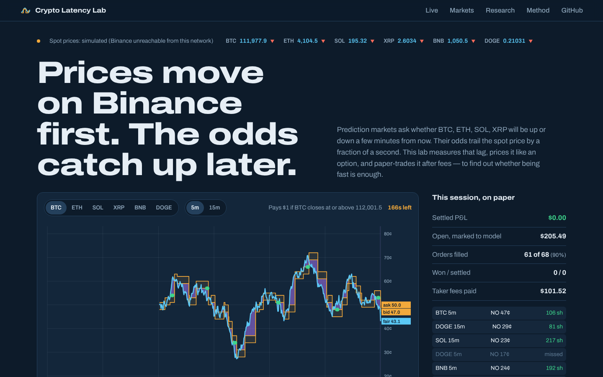

# Crypto Latency Lab

Viral posts claim bots get rich because crypto prices move on Binance first and everywhere else a
moment later. This project measures that claim on **real, live data**: it streams order books from
Binance, Coinbase, Kraken, OKX and Bybit, times how long each exchange takes to follow a move on
Binance, and checks whether the gaps in between survive real trading fees and real latency. A second
part asks the same question for Polymarket-style "up or down in 5 minutes" markets, using an
option-pricing model and a simulator (Polymarket is blocked in France).

**Live site:** https://kaushik899.github.io/crypto-latency-lab/

> Research and paper trading only. Nothing in this repository signs, sends or places orders.
> No exchange account or API key is needed or used.



## Real data: recorded session

20.8 minutes of live quotes captured from Paris on 20 October 2026 (`data/research/real-session.json`),
all six coins, measured in the site's real-data mode with the clock synced to Binance.

| Exchange | Feed delay to Paris (median) | Follows a Binance move in (median) | Moves timed | Taker fee |
|---|---|---|---|---|
| Binance | 155 ms | leader | — | 0.10% |
| Coinbase | 53 ms | 350 ms | 105 | 0.50% |
| Kraken | 21 ms | 300 ms | 115 | 0.80% |
| OKX | 125 ms | 300 ms | 112 | 0.10% |
| Bybit | 97 ms | 350 ms | 114 | 0.10% |

Binance does lead: when it moves, the other four take roughly 300–350 ms to cover half the move, even
though Binance's own feed reaches Paris *slower* than theirs. But in the whole session, **not one**
cross-exchange gap was larger than the two taker fees needed to trade it (0.20% for the cheapest pair),
so latency-checked paper P&L was **$0**. The lag is real; at retail fees it is not tradable. The
viral "price gap" profits need maker rebates or VIP fee tiers, co-location, and capital pre-positioned
on every exchange.

## Simulation: Polymarket-style markets (4 random days × 6 h × 612 markets per scenario)

| Scenario | P&L at 150 ms on $10k | Break-even latency | Half of gaps gone within |
|---|---|---|---|
| No fee, slow rivals (~400 ms) | **+$7,729** (t = 3.7) | ~930 ms | ~120 ms |
| Taker fee, slow rivals | **+$5,950** (t = 3.0), $2,835 paid in fees | ~740 ms | ~90 ms |
| Taker fee, crowded (rivals ~20 ms, makers re-quote every 0.3 s) | **−$1,513** (t = −1.8) | **~39 ms** | ~30 ms |

The edge the posts describe is real in a slow, fee-free market. Polymarket's crypto taker fee
(`0.07 × p × (1 − p)` per share, 1.75¢ at 50¢) removes about a quarter of it. Fast competition removes
the rest: once rivals react in tens of milliseconds, the orders that still fill are the ones the market
was right about. These numbers come from a simulator whose assumptions are explicit parameters
(`latlab/sim.py`); they show which assumptions the profit depends on, not what anyone would earn.

## What's inside

```
latlab/
  pricing.py     digital-option fair value (normal, Student-t, Merton jump-diffusion), jump-robust EWMA vol
  fees.py        Polymarket taker fee model
  feeds/         five exchange websockets (exchanges.py) · Binance · Polymarket Gamma + CLOB order books
  leadlag.py     record real quotes from five exchanges; catch-up times, lead-lag, fee-aware gaps
  tape.py        time-aligned record of spot + books (from simulation or from a live recording)
  sim.py         correlated GBM + stochastic vol + jumps, oracle basis, lagging market maker, rival latency bots
  strategy.py    fee-aware signals, latency-delayed paper execution, Kelly sizing, global capital ledger
  metrics.py     P&L, hit rate, t-stat, Sharpe, drawdown, Brier score, calibration
  research.py    the study: latency sweeps over seeds, fee/competition regimes, gap lifetimes, model risk
  live.py        live monitor + paper trader + recorder (all six coins)
  tapes.py       recording → tape for the backtester
web/             React + TypeScript site: live race chart, market board, research charts, method
tests/           24 tests (pricing, fees, order books, simulator invariants, capital limits, P&L accounting)
```

## Assets

BTC, ETH, SOL, XRP, BNB and DOGE, all priced from Binance spot. Polymarket lists short-dated Up/Down
markets for BTC, ETH, SOL and XRP; BNB and DOGE are covered by the live fair-value monitor and the simulator.

## Run it

```bash
python -m venv .venv && source .venv/bin/activate
pip install -r requirements.txt
pytest -q

python -m latlab.leadlag record --minutes 30                # real quotes from five exchanges
python -m latlab.leadlag analyze data/recordings/leadlag-<time>

python -m latlab.research                                   # simulated study (≈8 min) → data/research/results.json
python -m latlab.live --minutes 60 --record                 # live monitor + paper trader + recorder
python -m latlab.tapes data/recordings/<run>                # build a tape from the recording
python -m latlab.research --tape data/recordings/<run>/tape # same study on real data

cd web && npm install && npm run dev                        # website
```

## Method in one paragraph

An Up/Down contract pays $1 if the oracle price at the close is at or above the open: a cash-or-nothing
digital, worth `Φ([ln(S/K) − σ²τ/2] / σ√τ)` with zero drift. σ is a jump-robust exponentially weighted
estimate from tick data. A signal fires when `fair − ask − fee` exceeds 1.5¢. The order then arrives
`latency` later and fills only at the book that exists at that moment, within one tick of the signal
price, capped by displayed size and a global capital budget. Positions settle on the oracle price.

## Limitations

- Polymarket settles on Chainlink's price; the live tools use Binance as a proxy. The simulator models the
  basis between them.
- Simulated makers and rivals are stylised. Real books have queue priority, partial fills and makers who
  widen spreads when they are picked off.
- Polymarket is blocked for users in France (ANJ order, July 2026) and restricted elsewhere. Check what
  applies where you are before collecting data.

## Author

Prashasth Kaushik Guda — MSc in Management, SKEMA Business School (Paris).
